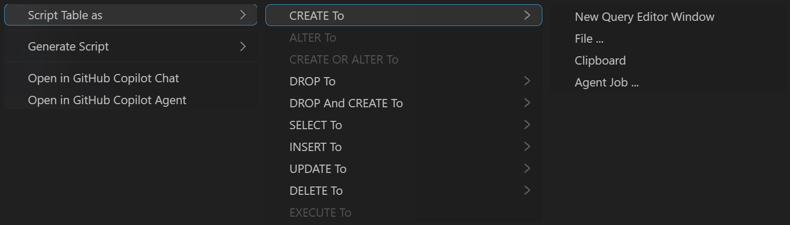
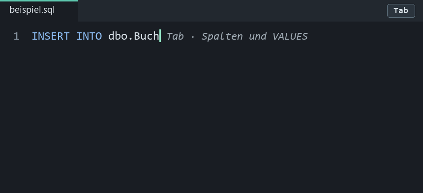

# SQL-Toolbelt für VS Code

Spaltennamen abtippen? Setz den Cursor hinter das Sternchen und drück <kbd>Tab</kbd>. SQL-Toolbelt ergänzt Microsofts MSSQL-Erweiterung um SQL-Vorlagen direkt im Editor und das aus SSMS vertraute Tabellenmenü **Script Table as**.

## Vom Rechtsklick zum Tabellenskript

Klicke im **MSSQL-Objekt-Explorer** mit der rechten Maustaste auf eine Tabelle. Mit **Script Table as → CREATE To → New Query Editor Window** öffnest du ihre Definition in einem neuen SQL-Editor.



Über dasselbe Menü erzeugst du auch SELECT, INSERT, UPDATE, DELETE oder ein kombiniertes DROP und CREATE. Als Ziel kannst du den Editor, eine Datei, die Zwischenablage oder einen Entwurf für einen SQL-Agent-Job wählen. Du entscheidest anschließend, ob du das Skript ausführst.

## Drei Abkürzungen mit Tab

Öffne einen verbundenen SQL-Editor und wähle in der Befehlspalette **SQL Developer Toolkit: Datenbank aus SQL-Editor übernehmen**. Sobald der Hinweis am Cursor erscheint, ist die Ergänzung bereit. Beide Demos verwenden die fiktive Tabelle `dbo.Buch`.

### `SELECT *` → Spalten ausschreiben

Setz den Cursor direkt hinter `*` und drück <kbd>Tab</kbd>. Aus dem Sternchen werden hier `[Id]`, `[Titel]` und `[Seiten]`. Bei `SELECT b.*` bleiben die ergänzten Spalten mit dem Alias `b` qualifiziert.


### `INSERT INTO` → Spalten und Werte ergänzen

Drück <kbd>Tab</kbd> direkt hinter `INSERT INTO dbo.Buch`. Du bekommst die Spaltenliste und einen passenden `VALUES`-Block. Im Beispiel erzeugt die Datenbank die ID selbst. Zum Ausfüllen bleiben Titel und Seitenzahl.



### `EXEC` → Prozedurparameter ergänzen

Drück <kbd>Tab</kbd> direkt hinter `EXEC [dbo].[GetTotal]`. Über dem Aufruf stehen dann typisierte `DECLARE`-Variablen für alle Parameter. Der Aufruf übergibt sie mit Namen. Hat die Prozedur Ausgabeparameter, zeigt ein `SELECT` darunter deren Werte. Fülle die Eingabevariablen vor dem Ausführen aus.

## Ausprobieren

Du brauchst Desktop-VS-Code ab **1.105**, **Node.js ab 22** mit npm und Microsofts Erweiterung [SQL Server (mssql)](https://marketplace.visualstudio.com/items?itemName=ms-mssql.mssql). Der Referenzstand für den klassischen Objekt-Explorer ist MSSQL 1.48.0.

```sh
git clone https://github.com/PaddyBlanco/VSC-SQL-Toolbelt.git
cd VSC-SQL-Toolbelt
npm ci --ignore-scripts
npm test
code .
```

Starte mit **F5** die Konfiguration **SQL Developer Toolkit lokal testen**. Wenn du SQL-Toolbelt dauerhaft in deinem VS Code verwenden möchtest, baue und installiere die VSIX im Projektordner.

```sh
npx --yes --package=@vscode/vsce@4.1.1 vsce package --no-dependencies --out sql-toolbelt.vsix
code --install-extension ./sql-toolbelt.vsix
```

## Mitwirken

Beschreibe im Issue den Aufruf, das erwartete Ergebnis und deine Versionen. Verwende für Screenshots und SQL-Beispiele eine fiktive Datenbank. Generierte Skripte können echte Objektdefinitionen enthalten. Für Pull Requests bitte `npm test` ausführen und das Ergebnis angeben.

[Issue öffnen](https://github.com/PaddyBlanco/VSC-SQL-Toolbelt/issues) · [Sicherheitslücke privat melden](https://github.com/PaddyBlanco/VSC-SQL-Toolbelt/security/advisories/new) · [Sicherheitsrichtlinie](SECURITY.md) · [MIT-Lizenz](LICENSE)
